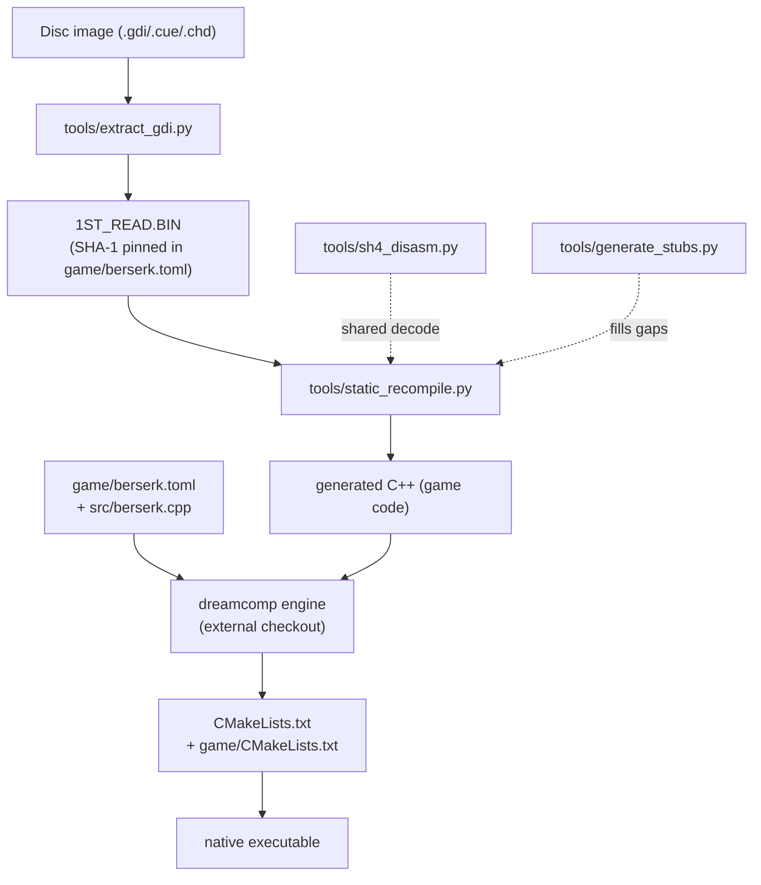
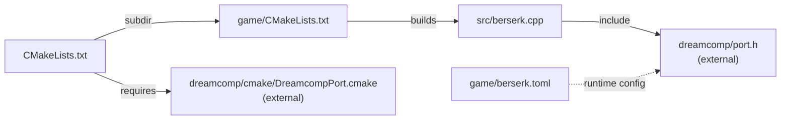
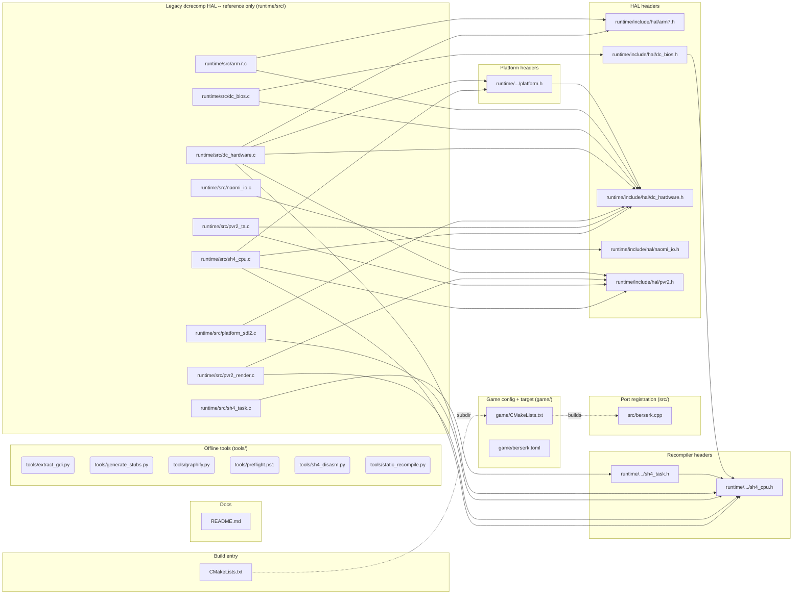

# Code graph

Generated by [`tools/graphify.py`](../tools/graphify.py) -- do not edit by hand.

Regenerate after moving files or changing includes:

```
python tools/graphify.py          # rewrite this file + code-graph.json/.dot
python tools/graphify.py --check  # fail if the committed graph is stale
```

28 nodes, 26 internal edges, 11 external headers.

This repository holds only the game-specific parts of the port; the engine itself
(dreamcomp: translator, Vulkan PVR2, AICA, GD-ROM, Maple, launcher) lives in an
external checkout and therefore appears here as a boundary, not as nodes.

## 1. Build and data flow

Conceptual pipeline, from `README.md` and `docs/START-HERE.md`; sections 3-6 are
measured from the tree.



## 2. Compiled graph (what the build actually consumes)

Only `src/berserk.cpp` is compiled from this repo. `runtime/` is a legacy
dcrecomp HAL kept for reference: no CMakeLists references it.



## 3. Full internal dependency graph

Every local `#include`, Python `import`, CMake `add_subdirectory` and
source listed in a CMake target found in the tree.



## 4. Graph shape

- **Cycles:** none
- **Deepest include chain:** `runtime/src/dc_bios.c` -> `runtime/include/hal/dc_bios.h` -> `runtime/include/recompiler/sh4_cpu.h`
- **Most depended-on headers:** `runtime/include/hal/dc_hardware.h` (7), `runtime/include/recompiler/sh4_cpu.h` (6), `runtime/include/hal/pvr2.h` (4), `runtime/include/hal/arm7.h` (2), `runtime/include/platform/platform.h` (2)
- **Standalone entry points** (no internal include/import in either direction): `src/berserk.cpp`, `tools/extract_gdi.py`, `tools/generate_stubs.py`, `tools/graphify.py`, `tools/preflight.ps1`, `tools/sh4_disasm.py`, `tools/static_recompile.py`

## 5. Node inventory

| Node | Layer | Lines | Depends on |
|------|-------|-------|------------|
| `CMakeLists.txt` | build | 17 | `game/CMakeLists.txt` |
| `README.md` | docs | 105 | -- |
| `game/CMakeLists.txt` | config | 7 | `src/berserk.cpp` |
| `game/berserk.toml` | config | 32 | -- |
| `runtime/include/hal/arm7.h` | hal-headers | 82 | -- |
| `runtime/include/hal/dc_bios.h` | hal-headers | 54 | `runtime/include/recompiler/sh4_cpu.h` |
| `runtime/include/hal/dc_hardware.h` | hal-headers | 214 | -- |
| `runtime/include/hal/naomi_io.h` | hal-headers | 96 | -- |
| `runtime/include/hal/pvr2.h` | hal-headers | 97 | -- |
| `runtime/include/platform/platform.h` | platform-headers | 42 | `runtime/include/hal/dc_hardware.h` |
| `runtime/include/recompiler/sh4_cpu.h` | recompiler-headers | 275 | -- |
| `runtime/include/recompiler/sh4_task.h` | recompiler-headers | 59 | `runtime/include/recompiler/sh4_cpu.h` |
| `runtime/src/arm7.c` | runtime | 688 | `runtime/include/hal/arm7.h`, `runtime/include/hal/dc_hardware.h` |
| `runtime/src/dc_bios.c` | runtime | 361 | `runtime/include/hal/dc_bios.h`, `runtime/include/hal/dc_hardware.h` |
| `runtime/src/dc_hardware.c` | runtime | 1322 | `runtime/include/hal/dc_hardware.h`, `runtime/include/hal/arm7.h`, `runtime/include/hal/pvr2.h`, `runtime/include/recompiler/sh4_cpu.h`, `runtime/include/platform/platform.h` |
| `runtime/src/naomi_io.c` | runtime | 216 | `runtime/include/hal/naomi_io.h` |
| `runtime/src/platform_sdl2.c` | runtime | 223 | `runtime/include/recompiler/sh4_cpu.h`, `runtime/include/hal/dc_hardware.h` |
| `runtime/src/pvr2_render.c` | runtime | 380 | `runtime/include/hal/pvr2.h`, `runtime/include/recompiler/sh4_cpu.h` |
| `runtime/src/pvr2_ta.c` | runtime | 518 | `runtime/include/hal/pvr2.h`, `runtime/include/hal/dc_hardware.h` |
| `runtime/src/sh4_cpu.c` | runtime | 1225 | `runtime/include/recompiler/sh4_cpu.h`, `runtime/include/hal/dc_hardware.h`, `runtime/include/hal/pvr2.h`, `runtime/include/platform/platform.h` |
| `runtime/src/sh4_task.c` | runtime | 183 | `runtime/include/recompiler/sh4_task.h` |
| `src/berserk.cpp` | port | 21 | -- |
| `tools/extract_gdi.py` | tools | 256 | -- |
| `tools/generate_stubs.py` | tools | 139 | -- |
| `tools/graphify.py` | tools | 515 | -- |
| `tools/preflight.ps1` | tools | 113 | -- |
| `tools/sh4_disasm.py` | tools | 916 | -- |
| `tools/static_recompile.py` | tools | 1564 | -- |

## 6. External dependencies

| Provides | Headers / libraries |
|----------|--------------------|
| C standard library | `stdbool.h`, `stdint.h`, `stdio.h`, `stdlib.h`, `string.h` |
| OpenGL / GLEW | `GL/glew.h` |
| SDL2/SDL3 | `SDL.h`, `SDL_opengl.h` |
| Win32 API | `windows.h` |
| Win32 API (dbghelp) | `dbghelp.h` |
| dreamcomp engine (external checkout) | `dreamcomp/port.h` |
